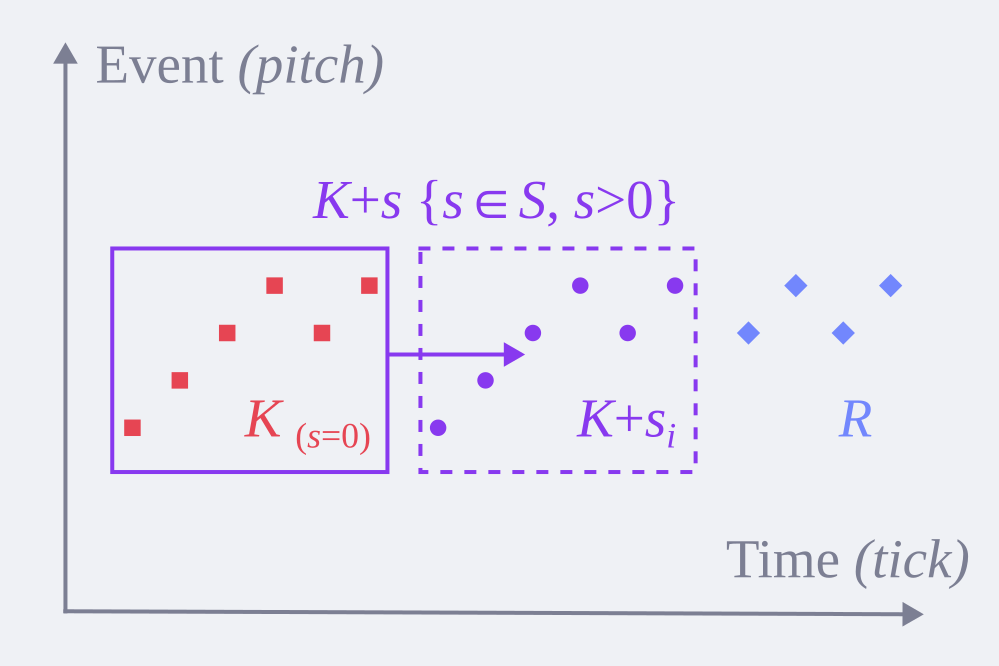

# 平移等价类 (TEC)

平移等价类描述一组模板结构按时间模式的离散卷积，且模板结构始终作为支撑集。

## TEC 与结构

平移等价类 (Translation Equivalence Class) 表示一组 _K (+) S_ 结构，但 TEC 是 _K (+) S_ 更具体的定义，它按 _0 ∈ S & ∀s ∈ S, s ≥ 0_ 约束时间模式的集合 _S_ 必然包含 _0_ 且非负。处于原点位置的 _K_ 由于 _K = K + 0_ 使 _S_ 的偏移等同于对 _K (s = 0)_ 模板自身的相对偏移，这意味着 _K_ 可以被视作是一个标准的锚定在时间原点 _0_ 处的模板多重集，_S_ 集合的任意非零元素 _s {s ∈ S, s ≠ 0}_ 可以视作是 _K_ 在时间维度上偏移 _s_ 后得到的副本的叠加。

事件枚举在时间重复的形式规则使内在结构形式化，结构以各种 TEC 的形式涌现，而不同 TEC 之间可能产生争抢而互相冲突。
